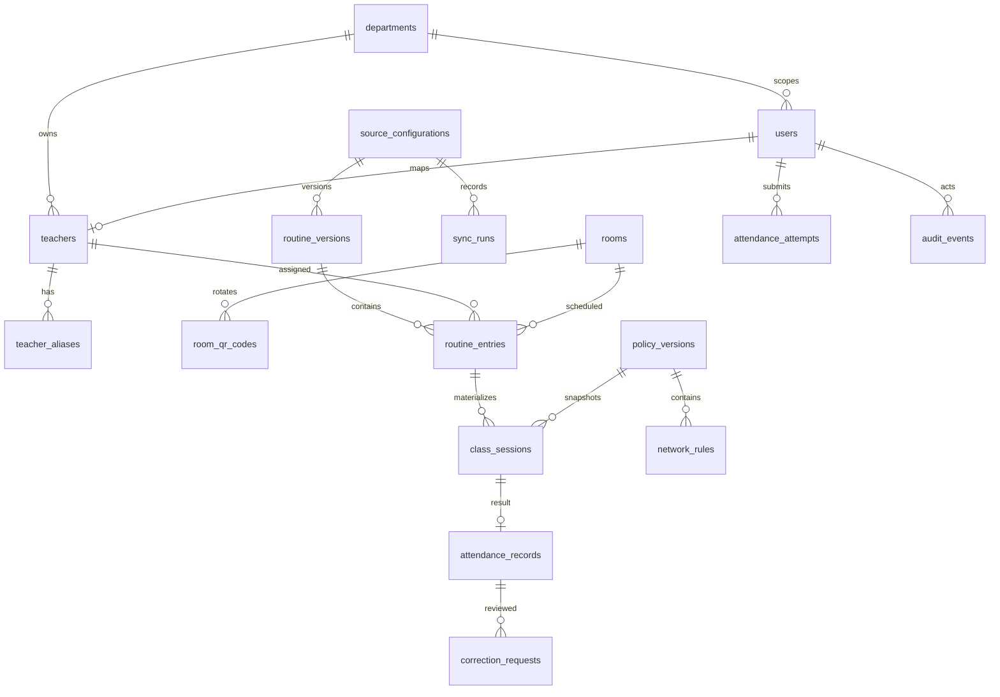

# Database schema

Key database constraints include unique provider subject and email, department-scoped alias tuples, unique room identity, token hashes, routine source keys per version, deterministic session occurrence keys, one attendance record per session/assigned teacher, and one idempotency key per actor. Composite indexes cover teacher/start, department/teaching date, room/start, attendance result, and audit target/time.
